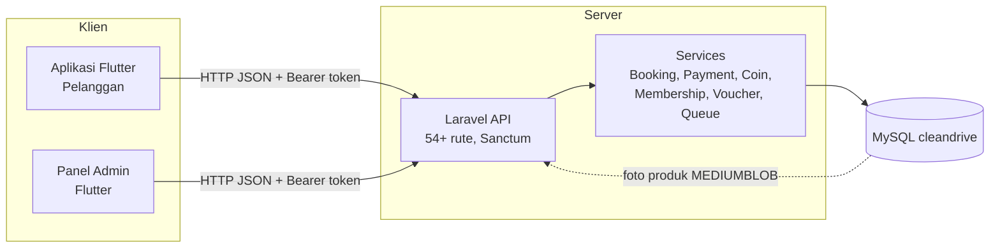
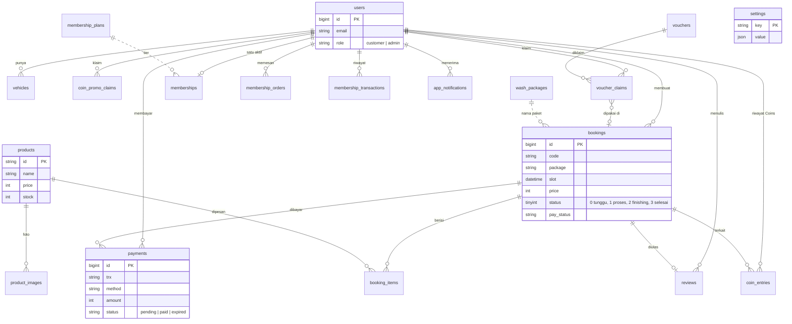
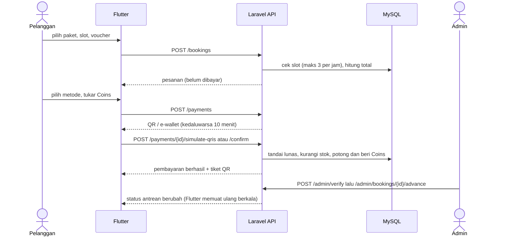

# Diagram CleanDrive

Diagram memakai Mermaid. GitHub, VS Code (ekstensi *Markdown Preview Mermaid Support*), dan https://mermaid.live
dapat menampilkannya. Untuk laporan, ekspor sebagai gambar dari mermaid.live.

## 1. Arsitektur

Semua perhitungan (harga, diskon, kapasitas slot, stok, Coins) dilakukan di server. Flutter hanya menampilkan.
Mode demo tanpa server: `--dart-define=USE_MOCK=true` (data tiruan di memori).

## 2. Relasi antartabel (ERD)

Catatan: `membership_plans.tier` dan `wash_packages.name` dihubungkan lewat nilai (bukan foreign key).
Tabel `settings` menyimpan pengaturan reward Coins buatan admin.

## 3. Alur pemesanan dan pembayaran

